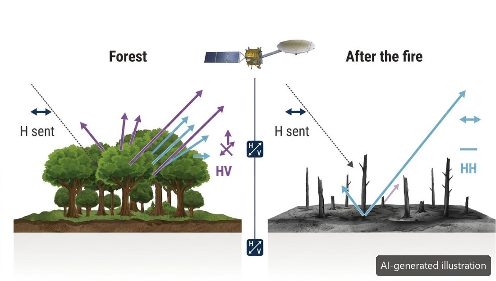

# Fire Before the Storm: Ash Watch

**The fire is out. The danger isn't.**

See the live story site: **[andrea-s90.github.io/Fire-Before-The-Storm](https://andrea-s90.github.io/Fire-Before-The-Storm/)**.

> We're Andrea, a mathematician and student at 42, and Maria, a BI analyst and bioinformatician. Last August
> we travelled to central Spain to watch the eclipse and ended up watching wildfires instead. By October those
> same towns were back in the news, this time because autumn rain was washing ash into their drinking water.
> The fire was out, but the danger wasn't. That's why we built Ash Watch.

Ash Watch is a post-fire warning for drinking water. After a wildfire it tells each town downstream how its
water could be polluted, by which pathway, and how confident that estimate is. It is built on NASA-ISRO NISAR
L-band radar, which measures the forest before the fire, the burn through smoke, and the regrowth afterwards.

Project for the [NASA Space Apps Challenge 2026](https://www.spaceappschallenge.org/2026/), challenge
*Dancing with the SARs*. Team: Andrea Serio and Maria Golikova. Demo case: the Burgohondo fire in Ávila,
Spain (July 2026) and the ash-laden runoff that followed the first autumn rain in October.


## How it works

```
NISAR GCOV (HH, HV) ─┐
Sentinel-2, DEM,     ├─►  pipeline/ (Python, 13 steps)  ─►  web/public/data/  ─►  web/ story site
biomass, soil, wind, ┘    13 steps, run once per fire        small files            static, MapLibre
rain, OpenStreetMap                                          (the data contract)
```

| Pathway | Question for the town | Confidence |
| --- | --- | --- |
| Surface runoff | Will rain wash ash and sediment into the stream or reservoir we drink from? | High |
| Debris flow | Can one storm send mud and ash into our intakes? | Medium: model calibrated in the western US |
| Groundwater | Should we test our wells and springs? | Screening only |
| Airborne ash | Did ash fall on our reservoir, and can dry ash still blow in? | Indicative only |

### How NISAR sees a forest



*AI-generated illustration (schematic, not to scale).*

NISAR sends 24 cm L-band microwaves, polarized horizontally (H), through smoke and cloud. Branches and trunks
bounce them around and turn part of the echo vertical: a strong HV signal. When the canopy burns, HV drops.
Bare ground echoes mostly H (HH), which rises on wet soil: HV down means burned, HH up alone means rain.

Methods, one paragraph each: [pipeline/README.md](pipeline/README.md). Full plan:
[Fire Before the Storm — Ash Watch build plan.md](Fire%20Before%20the%20Storm%20%E2%80%94%20Ash%20Watch%20build%20plan.md).

## Repository

```
pipeline/           processing steps 01 to 13, config, run scripts, synthetic end-to-end test
web/                story site: Vite + React + MapLibre GL
  public/data/      exported files, written by pipeline step 12 (the data contract)
  src/chapters.js   the story as data: text, camera and layers per chapter
tools/check_data.py checks the exported files against the contract
docs/               data contract, site concepts
.github/workflows/  CI on every pull request, deploy to GitHub Pages on main
CLAUDE.md           how the two of us (and Claude Code) work in this repository
```

## Run the site

```bash
cd web
npm install
npm run dev
```

Open http://localhost:5173. The site reads `web/public/data/` as committed; no pipeline run is needed.

## Check the data

```bash
python tools/check_data.py
```

Standard library only. Errors mean the site would break or show something wrong; warnings mean a number
looks implausible and needs a human look. The same check runs in CI and before each deploy.

## Run the pipeline

Runs on one Linux or macOS machine. Needs a NASA Earthdata login, a Copernicus CDS key and either 100 GB of
free disk or about 30 GB with the pass-by-pass download. See [pipeline/README.md](pipeline/README.md). A smoke
test on synthetic data needs no downloads:

```bash
cd pipeline
bash tests/run_synthetic.sh /tmp/aw_test
```

## Limits, stated plainly

- One fire is a case study, not a validation.
- The debris-flow model (Staley et al. 2017, M1) was calibrated in the western United States; read its output
  as a ranking.
- Burn severity classes come from Sentinel-2 dNBR where the ground is visible; the radar confirms the burn and
  fills cloud and smoke gaps.
- L-band HV saturates near 100 Mg/ha of biomass, so ash in dense stands is a lower bound.
- IMERG rain is a 10 km, 30-minute average and underestimates short storm peaks.
- Groundwater and airborne ash have no local measurements behind them and are labelled screening and
  indicative.

## About

The same facts as the About section at the bottom of the site, under the headings of the Space Apps project
page. The site reads them from [web/src/project.js](web/src/project.js): change both together.

**Ash Watch** · Fire Before the Storm (Barcelona local event): Andrea Serio and Maria Golikova · Challenge:
*Dancing with the SARs*

### Links

- Project demo: to come
- Live site: to come
- [Source code](https://github.com/Andrea-S90/Fire-Before-The-Storm)

### NASA data

- [NISAR L2 GCOV (NASA-ISRO), L-band HH and HV backscatter, from the ASF DAAC](https://nisar-docs.asf.alaska.edu/products-overview/)
- [GPM IMERG Late Run V07, half-hourly rainfall, for the October hindcast](https://gpm.nasa.gov/data/imerg)
- [NASA Earthdata Login and Search, used to find and download both](https://www.earthdata.nasa.gov/)

### Space agency partner data and other sources

- [ISRO: NISAR is a joint NASA-ISRO mission](https://www.isro.gov.in/NISARSatellite.html)
- [ESA / Copernicus Sentinel-2 L2A, burn severity (dNBR), via the Earth Search STAC catalogue](https://earth-search.aws.element84.com/v1)
- [ESA CCI Biomass, above-ground biomass used to calibrate the fuel estimate](https://climate.esa.int/en/projects/biomass/)
- [Copernicus DEM GLO-30, terrain and flow routing, and the relief of the 3D and AR model](https://registry.opendata.aws/copernicus-dem/)
- [ERA5 hourly wind (Copernicus Climate Change Service)](https://cds.climate.copernicus.eu/)
- [ISRIC SoilGrids, soil texture and organic carbon for erodibility](https://soilgrids.org/)
- [OpenStreetMap contributors: towns, reservoirs, wells and springs](https://www.openstreetmap.org/copyright)

### References and tools

- [Staley et al. (2017), the M1 post-fire debris-flow likelihood model (USGS)](https://doi.org/10.1016/j.geomorph.2016.10.019)
- [Yu and Saatchi (2016), sensitivity of L-band radar to forest biomass](https://mdpi.com/2072-4292/8/6/522)
- [Quigley et al. (2019), ash produced per unit of fuel consumed](https://link.springer.com/doi/10.1186/s42408-018-0015-7)
- [Reuters via KFGO (7 Oct 2026), the report of the contaminated water supply](https://kfgo.com/2026/10/07/wildfire-ash-turns-spanish-mountain-river-black-contaminating-water-supply/)
- [El Debate (28 Jul 2026), Casavieja without power or drinking water during the fire](https://www.eldebate.com/espana/castilla-y-leon/20260728/casavieja-pueblo-abulense-sobrevive-escenario-guerra-luz-agua_444145.html)
- [Key and Benson (2006), the Normalized Burn Ratio and its severity classes (USDA Forest Service, FIREMON)](https://research.fs.usda.gov/treesearch/24066)
- [MapLibre GL JS](https://maplibre.org/)
- [model-viewer (Google), the 3D and AR viewer](https://modelviewer.dev/)
- [OpenFreeMap basemap (OpenMapTiles, OpenStreetMap)](https://openfreemap.org/)

### Use of AI

The pipeline code, the site code and the documentation were written with Claude Code (Anthropic), directed and
reviewed by the team; commits made that way carry a Co-Authored-By line. The idea, the choice of methods and
the interpretation are ours.

### Team

- [Andrea Serio](https://www.linkedin.com/in/andrea--serio) (LinkedIn)
- [Maria Golikova](https://www.linkedin.com/in/maria-golikova-bi/) (LinkedIn)

### Acknowledgements

- [NASA International Space Apps Challenge](https://www.spaceappschallenge.org/), funded by NASA's Science
  Mission Directorate, for the challenge and the data
- [42 Barcelona](https://www.42barcelona.com/) (Fundación Telefónica), for hosting the Barcelona local event at
  its campus in the Parc Tecnològic
- [The Barcelona local event](https://www.spaceappschallenge.org/2026/local-events/barcelona/) organisers and
  mentors

## License

Apache-2.0, see [LICENSE](LICENSE).
